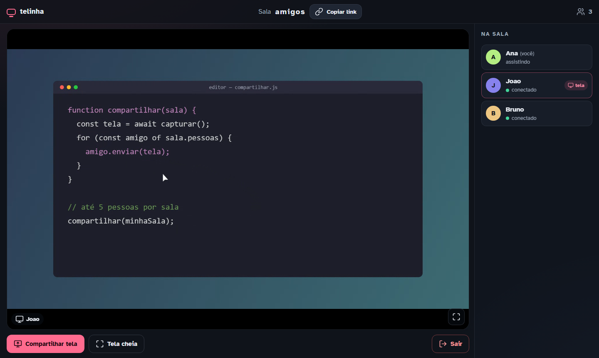
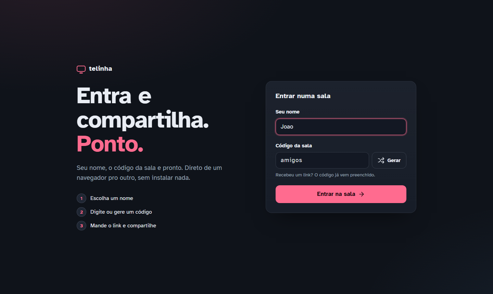

# telinha

Compartilhar a tela com os amigos sem instalar nada e sem criar conta. Você coloca o nome e o código da sala, entra e compartilha.

- Salas com várias pessoas, e várias podem compartilhar ao mesmo tempo. Se quiser, dá para definir um limite por sala (`MAX_PEERS`).
- O vídeo vai **direto de navegador para navegador** (WebRTC P2P) e não passa pelo seu servidor, a não ser quando o TURN precisa retransmitir.
- É **leve**: HTML, CSS e JS puros, sem framework e sem build. O servidor é Node com uma única dependência (`ws`) e usa ~15 MB de RAM.
- Pensado para hospedar você mesmo numa VPS pequena (1 vCPU / 1 GB sobra).



<details>
<summary>Tela de entrada</summary>


</details>

## O que dá pra fazer

- Gerar um código de sala ou digitar um, e mandar o link `https://seu-dominio/?sala=codigo` para os outros.
- Compartilhar a tela, uma janela ou uma aba, vendo uma prévia do que está saindo, e parar quando quiser.
- Com uma tela compartilhada, ela ocupa o palco. Com várias, aparecem em grade e um clique destaca uma.
- Ver qualquer tela em tela cheia, a lista de quem está na sala e o estado da conexão de cada um.
- No celular só dá pra assistir: o navegador do celular não permite compartilhar a tela.
- Se a conexão cair, o site reconecta sozinho, e você volta para a mesma sala sem derrubar o vídeo dos outros.

## Como funciona

```
 navegador A ──── vídeo P2P (WebRTC) ──── navegador B
      │   └──── ou via TURN, se o NAT não deixar ───┘   │
      │                                               │
      └──────── WebSocket /ws (só sinalização) ───────┘
                   servidor Node (server/)
```

- **`server/server.js`** serve os arquivos de `public/` e a sinalização em `/ws`. Ele cuida das salas em memória, aplica o limite de pessoas (se houver) e gera uma credencial TURN temporária para cada pessoa.
- **`public/client.js`** é a API `window.Telinha`: WebRTC mesh com *perfect negotiation*, reconexão e detecção de relay.
- **`public/ui.js`** é a interface e só conversa com a API. Para fazer o seu visual, troque os três arquivos da UI. Veja [docs/PROTOCOLO.md](docs/PROTOCOLO.md).
- **coturn** é o servidor TURN. Sem ele, quem está atrás de NAT duplo, CGNAT, rede corporativa ou 4G muitas vezes não consegue conectar. Para ter o seu próprio servidor, considere o TURN obrigatório.

## Hospedar o seu

Você precisa de:

- uma VPS Linux com IP público e Docker;
- um domínio apontando para ela;
- HTTPS, porque o navegador só deixa compartilhar a tela em `https://`.

```bash
git clone https://github.com/joaovslacc/telinha.git
cd telinha
cp .env.example .env
#  edite o .env: DOMAIN, PUBLIC_IP e TURN_SECRET (gere com: openssl rand -hex 32)
```

Libere no firewall as portas do TURN:

```bash
ufw allow 3478/udp
ufw allow 3478/tcp
ufw allow 49160:49200/udp
```

Depois escolha **uma** das opções de HTTPS:

**A) Caddy embutido.** É o mais simples: ele pega o certificado sozinho. Precisa das portas 80 e 443 livres e de um registro DNS **A** do domínio apontando para o IP da VPS.

```bash
ufw allow 80/tcp && ufw allow 443/tcp
docker compose --profile https up -d --build
```

**B) Você já tem um proxy** (nginx, Traefik, Cloudflare Tunnel…):

```bash
docker compose up -d --build
```

Nesse caso, aponte o proxy para `http://127.0.0.1:3004` e lembre de liberar o upgrade de WebSocket em `/ws`. Se o proxy for o Cloudflare, ele cuida só do site: o TURN fala UDP direto com o `PUBLIC_IP` e não passa pelo Cloudflare, então as portas acima continuam necessárias.

Para conferir se subiu:

```bash
curl https://SEU-DOMINIO/healthz      # {"ok":true,...,"turn":true}
```

Para atualizar: `git pull && docker compose up -d --build`. Quem estiver numa sala reconecta sozinho.

> **VPS atrás de NAT** (AWS, GCP, Oracle…), onde a máquina só enxerga um IP privado: use
> `--external-ip=IP_PUBLICO/IP_PRIVADO` no comando do coturn em `docker-compose.yml`.

## Rodar local (desenvolvimento)

```bash
cd server
npm install
node server.js        # http://localhost:3004
```

O navegador trata `localhost` como seguro, então o compartilhamento funciona. Abra duas abas na mesma sala para testar.

Sem `TURN_HOST`/`TURN_SECRET`, o servidor usa só um STUN público, o que basta na mesma rede.

| Variável | Padrão | Para que serve |
|---|---|---|
| `PORT` | `3004` | porta HTTP |
| `HOST` | `0.0.0.0` | interface |
| `TURN_HOST` | — | IP/host público do coturn |
| `TURN_SECRET` | — | segredo compartilhado com o coturn (`static-auth-secret`) |
| `TURN_PORT` | `3478` | porta do coturn |
| `ALLOWED_ORIGINS` | — | lista de origens aceitas no WebSocket |
| `MAX_PEERS` | `0` | máximo de pessoas por sala (`0` = sem limite) |
| `PUBLIC_DIR` | `../public` | pasta dos arquivos do site |

## Limites e escolhas

- **Mesh, não SFU.** Quem compartilha envia uma cópia para cada pessoa, até ~2,5 Mbps cada. Com 4 assistindo, isso dá ~10 Mbps de upload. Não existe trava, mas na prática funciona bem até umas 6–8 pessoas, dependendo do upload de quem compartilha. Use `MAX_PEERS` se quiser limitar. Para salas grandes, o caminho é um SFU (LiveKit, mediasoup).
- **TURN sem TLS.** O TURN usa `turn:` em UDP/TCP na 3478, sem `turns:` na 443. Redes que só liberam a porta 443 não vão conectar. Para isso é preciso um certificado e `turns:` na configuração do coturn.
- **Navegadores.** Foi testado no Chrome/Chromium. Firefox e Safari devem funcionar, porque é WebRTC padrão, mas ainda não foram testados a fundo.
- **Sem áudio.** Só a imagem da tela é compartilhada.
- **Salas sem persistência.** Elas existem só enquanto tem gente dentro, e não existe conta nem histórico.

## Licença

[MIT](LICENSE)
